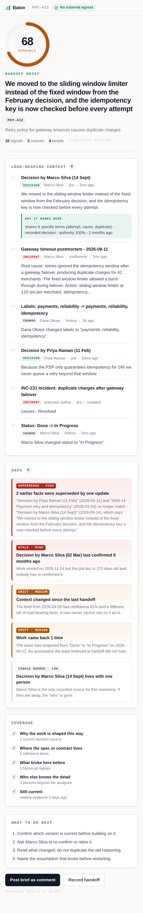
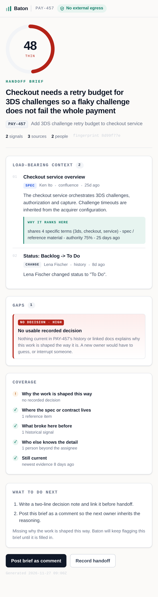
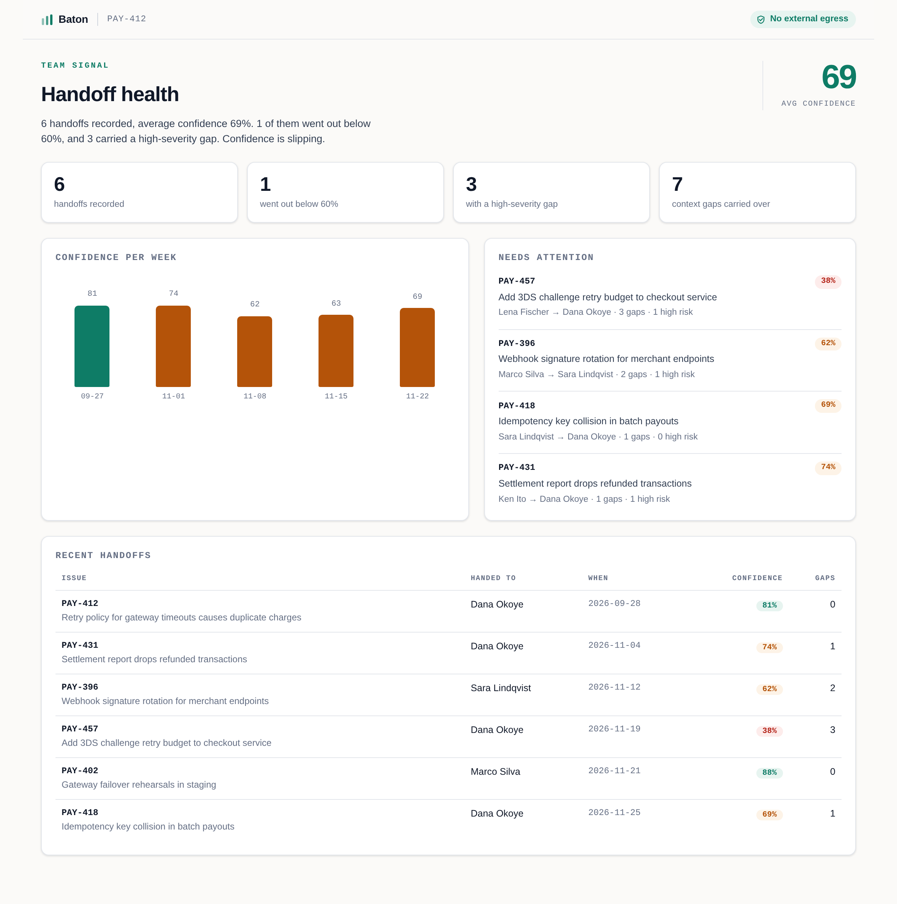

# Baton

**Handoff briefs for Jira — the reasoning, not just the ticket.**

Baton is an Atlassian Forge app for the moment work changes hands: someone goes on
leave, an issue is reopened, a new engineer picks up a stale ticket. Instead of a
wall of comments, the next owner gets a short brief with the load-bearing
decisions, the documents that matter, the incidents that shaped the design, what is
*no longer true*, and a confidence number that says how much of the story is
actually recorded.

Everything in the brief is traceable to a Jira comment, a changelog entry or a
Confluence page. There is no LLM in the loop, no external service, and no data
leaves Atlassian.



## Why

Handoffs fail quietly. The ticket says *what* is being built; the **why** lives in
a comment from February, a postmortem in Confluence, and one person's memory. The
new owner rebuilds the decision from fragments — or re-litigates a decision that
was already settled — and the team pays for it weeks later.

Atlassian's own theme for Codegeist 2026 is exactly this: *the right knowledge in
front of the right people at the right moment*. Baton makes that concrete for the
highest-cost moment in software work: the transfer of ownership.

What Baton does that a summary cannot:

- **Ranks by load-bearing weight, not recency.** A decision comment from September
  outranks a status change from yesterday.
- **Detects supersession.** "We moved to a sliding window limiter **instead of**
  the fixed window" retires two older facts — Baton says which ones and quotes the
  statement that retired them.
- **Names the gap when there is nothing.** No recorded decision ⇒ confidence 48,
  label `thin`, and the first next action is "write the decision down".
- **Scores itself.** Confidence comes from five coverage buckets (decision, spec,
  history, people, recency) minus penalties for stale, drifting or single-source
  context — a number you can argue with, because the reasons are printed.
- **Keeps a handoff history.** Each recorded handoff stores its confidence and
  fingerprint, so the team page can show whether handoffs are getting better or
  worse, and which recent ones went out thin.

## What it looks like

| Surface | Where | What it shows |
| --- | --- | --- |
| Issue panel | Jira issue, right sidebar | The brief: headline decision, confidence ring, ranked context with "why it ranks here", risks, gaps, next actions |
| Issue action | Jira issue, `•••` menu | One click: build the brief, post it as a comment, record the handoff |
| Global page | Jira top nav → Baton handoff health | Avg confidence, handoffs below 60%, trend by week, weakest handoffs first |
| Rovo agent | Rovo / Atlassian AI | "What do I need to know before I take over PAY-412?" → same engine, conversational answer |
| MCP tools | Atlassian MCP server | `baton-handoff-brief`, `baton-handoff-health` — the same two actions, callable from third-party agents |

| Thin brief | Handoff health |
| --- | --- |
|  |  |

## Run it

```bash
npm install

# typecheck + unit tests + offline app verification
npm run typecheck
npm test
npm run build && node scripts/verify.mjs

# real UI in a browser, no Atlassian account needed:
#   ?preview=1 renders recorded snapshots through the shipping bundle
npm run dev        # http://127.0.0.1:5173/index.html?preview=1&view=panel&issue=PAY-412

# regenerate the screenshots / the demo video
python3 scripts/screenshots.py
python3 scripts/demo.py
```

### Preview routes

| URL suffix | View |
| --- | --- |
| `?preview=1&view=panel&issue=PAY-412` | Issue panel, well-documented issue (confidence 68, `workable`) |
| `?preview=1&view=panel&issue=PAY-457` | Issue panel, no decision recorded (confidence 48, `thin`) |
| `?preview=1&view=health` | Handoff health page |
| `?preview=1&view=action&issue=PAY-412` | Issue action result |

Deployment to a real Atlassian site needs a human login; see [DEPLOY.md](DEPLOY.md).

## How it works

```
Jira REST (asApp)                  analysis (pure TS, no I/O)
  issue + comments + changelog ─┐
  links ────────────────────────┼─▶ extract ─▶ rank ─▶ analyze ─▶ brief
Confluence CQL (asApp) ─────────┘     │        │        │          │
  pages that mention the issue        │        │        │          ├─▶ ADF comment
                                      │        │        │          ├─▶ storage (history)
Forge storage (kvs) ──────────────────┴────────┴────────┘          └─▶ UI / Rovo / MCP
  previous brief + handoff index
```

**Extraction** (`src/shared/extract.ts`) turns the issue, its comments, changelog
entries, remote links and Confluence pages into typed signals: `decision`,
`spec`, `incident`, `discussion`, `change`. Cue phrases pick the kind ("we
decided", "instead of", "root cause"), participants are resolved from ADF
mentions and author accounts, and the *need* text is built only from the issue
itself — never from the documents being ranked, so ranking cannot chase its own
tail.

**Ranking** (`src/shared/rank.ts`) scores each signal 0–100:

```
score = 100 × (0.45·relevance + 0.25·authority + 0.18·freshness + 0.12·specificity)
```

- *relevance* — IDF-weighted cosine between the signal and the issue's need text,
  so words that are rare in this workspace count more than "update" or "payment";
- *authority* — decisions and postmortems outrank chatter;
- *freshness* — 120-day half-life, so a two-year-old decision fades but does not
  vanish;
- *specificity* — document length normalised: a one-line "LGTM" cannot win.

The panel prints the top contributing terms and the reason, e.g.
*"shares 6 specific terms (attempt, cause, duplicate) · recorded decision ·
authority 100% · 2 months ago"*.

**Analysis** (`src/shared/analyze.ts`) then finds what would burn the next owner:

| Risk | Trigger |
| --- | --- |
| `contradiction` | A newer statement with a replacement cue ("instead of", "no longer", "supersedes") whose *negated target* overlaps an older fact. Grouped by the replacing statement, so one update that retires three facts is one risk. |
| `stale` | The top current fact is older than any confirmed change and nobody re-confirmed it. |
| `drift` | The previous brief had a different fingerprint or confidence, or the issue went `Done → In Progress`. |
| `single-source` | Exactly one person is recorded for the reasoning. |
| `missing-decision` | No usable decision anywhere. |

The negated-target check is what stops a false positive: a March API contract that
also mentions idempotency is *not* marked superseded by a September comment about
the retry window, because the sentence negates "fixed window", not the contract.

**Confidence** is `coverage − penalties`, clamped to 8…97:

| Bucket | Weight |
| --- | --- |
| Why the work is shaped this way (decision) | 0.30 |
| Where the spec or contract lives | 0.20 |
| What broke here before | 0.20 |
| Who else knows the detail | 0.15 |
| Still current | 0.15 |

Penalties: `missing-decision` −22, other high −10, medium −5, low −2.
`≥75 strong`, `≥50 workable`, else `thin`.

**Determinism.** The brief carries a FNV-1a fingerprint of its ranked fact ids, and
the same issue + date always produces the same fingerprint. That is what makes
drift detectable ("the brief from 2026-09-28 had confidence 81% and a different set
of load-bearing facts").

## Built on Forge, inside the boundary

- `jira:issuePanel`, `jira:issueAction`, `jira:globalPage` — one React bundle
  (`static/baton`) shared by all three.
- `rovo:agent` with a resource prompt and four conversation starters, calling two
  `action` modules.
- `rovo:mcp` exposing the same two actions as MCP tools.
- Scopes: `read:jira-work`, `read:jira-user`, `read:confluence-content.all`,
  `storage:app`. No `external` permissions, no egress, no user impersonation.
- State in Forge storage (`@forge/kvs`): the last brief per issue and a capped
  handoff index.
- Runtime `nodejs22.x`, 256 MB, arm64.

## Tech

- Forge platform: `@forge/api` 8.5, `@forge/bridge` 7.4, `@forge/kvs` 2.1
- React 19 + Vite 8 + TypeScript 7 (strict), compiled with `tsc` for the
  resolvers and `vite build` for the UI
- Vitest 5 for the analysis engine and resolver contracts
- `@forge/manifest` 13.7 for offline manifest validation (the same validator
  `forge lint` uses)
- Playwright + Chromium for the screenshots and the demo video, ffmpeg for
  encoding

## Repo layout

```
manifest.yml              Forge app definition (modules, scopes, runtime)
src/shared/               analysis engine: text, extract, rank, analyze, brief, adf, metrics
src/resolvers/            Forge functions: Jira/Confluence reads, storage, handler
src/ui/                   React Custom UI (panel, health page, action view)
static/baton/             built UI bundle served by Forge
resource/agent/           Rovo agent prompt
tests/                    23 unit tests over the engine and the resolver entry point
scripts/                  verify (offline lint), screenshots, demo video
screenshots/, demo.mp4    real renders of the shipped bundle
RULES_NOTES.md            what the hackathon actually requires, with sources
SUBMISSION.md             Devpost fields, ready to paste
VIDEO_SCRIPT.md           timed narration for the <5 min video
DEPLOY.md                 the steps that need a human Atlassian login
```

## Limitations, stated plainly

- Confluence search is best-effort: if the app lacks access, the brief still
  renders and marks the docs bucket as unavailable rather than pretending.
- Comment and changelog reads are capped (60 comments, 200 changelog entries) to
  stay inside Forge execution limits on very old issues.
- Supersession is lexical, not semantic: it catches explicit replacement language.
  A decision reversed with no trace stays invisible — which is why `single-source`
  and `stale` exist as separate signals.
- `forge lint` needs an authenticated session; `scripts/verify.mjs` runs the same
  manifest validator plus egress and handler checks offline. See DEPLOY.md.

## License

MIT.
